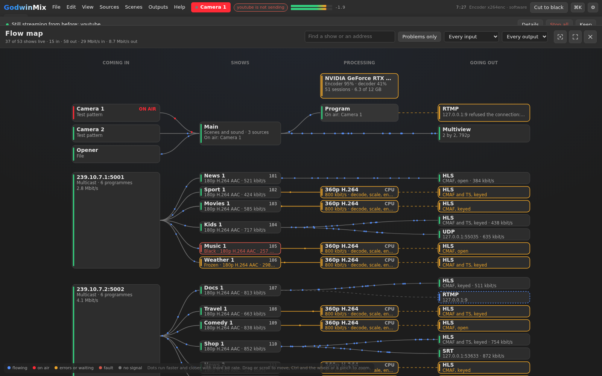
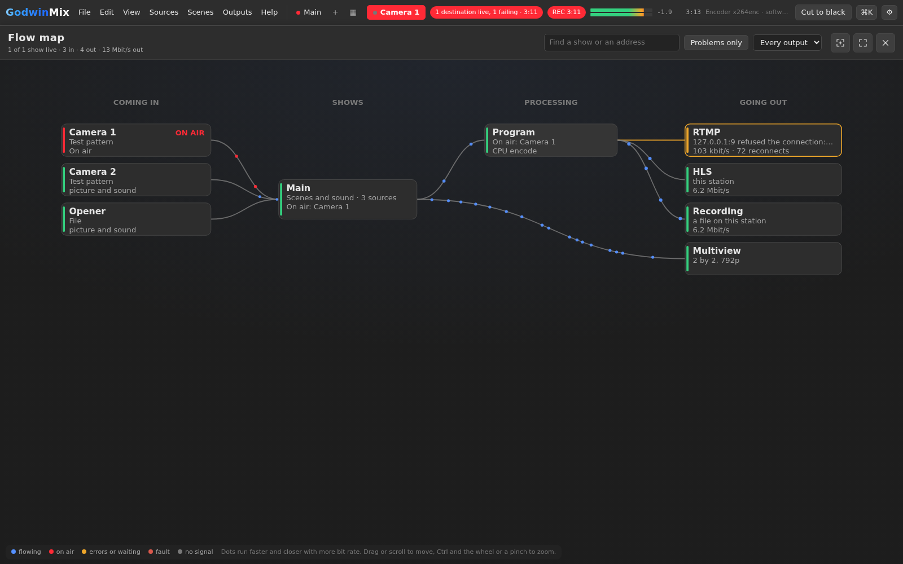
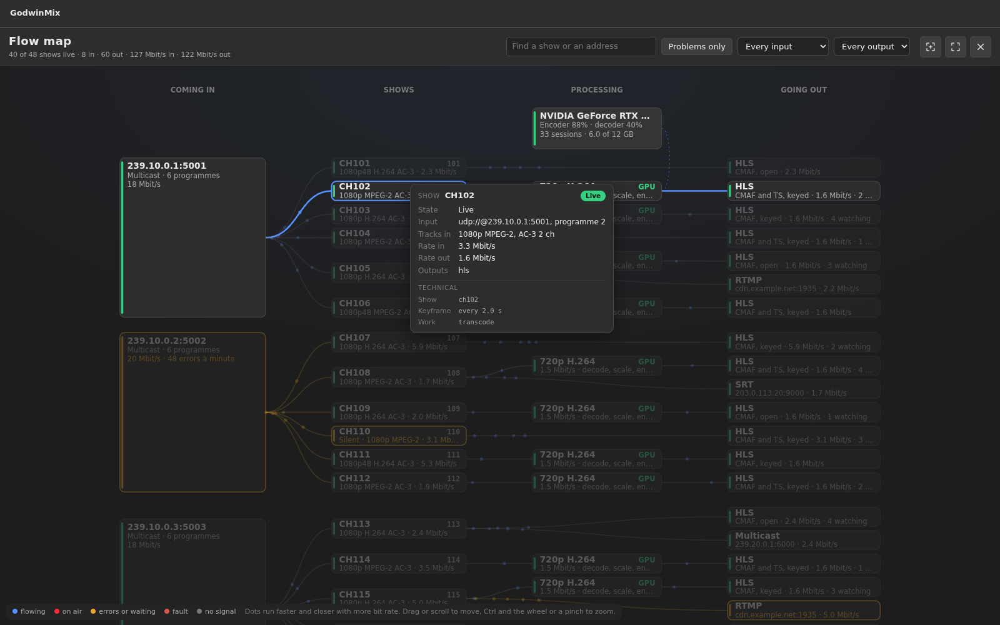
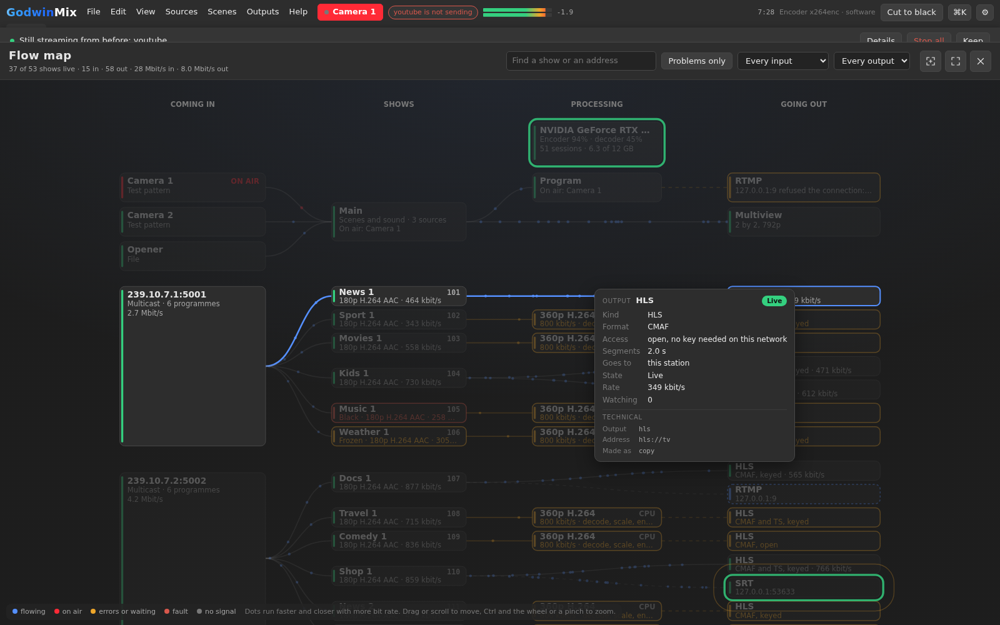
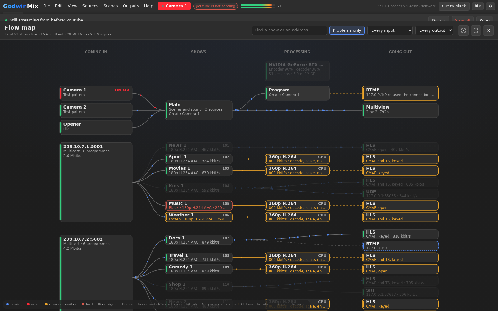
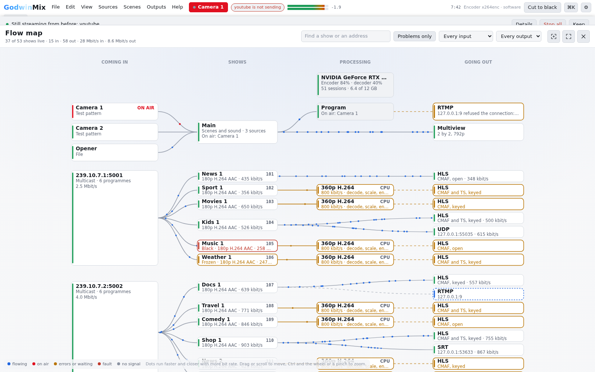
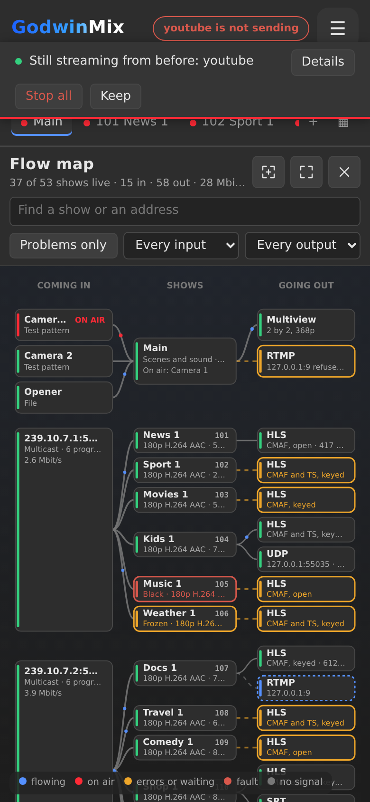

# Read the flow map

The flow map is one screen of a whole station: everything that comes in,
what each show does with it, and everything that goes out, with dots
running along every link at a pace set by its bit rate. It works the same
for a station with one mixed show and for one running two hundred
channels.

Open it from **View > Flow map**, or with the flow map button on the
headend view's top bar. On a phone it is under **More**. It reads nothing
until it is open and stops reading when it closes (Escape, or the cross at
the top right). The button beside the cross puts it full screen, for a
monitor on the wall.

## The four columns

Read it left to right.

1. **Coming in.** For a mixed show, each of its sources: a camera, a test
   picture, an SRT or RTMP feed, a file, a browser source, a graphic. For
   channels, each address they read. A multicast group that carries six
   programmes is one tall card beside the six channels it feeds, with its
   rate and how many continuity errors it had in the last minute.
2. **Shows.** Every show on the station. A channel's card has its number
   and name, the picture it gets (`1080i MPEG-2 AC-3`) and its rate. A
   mixed show's card says how many sources go into its scenes and sound,
   what is on air and what is in preview.
3. **Processing.** What is done to the picture before it goes out. A
   conversion says what it makes (`720p H.264`, `1.5 Mbit/s`) and where it
   runs: **GPU** when the picture stays on the graphics card from decode to
   encode, **CPU** when it does not. A mixed show's program is here, or its
   renditions when it makes more than one. The GPU itself is the card at
   the top of this column, with its encoder and decoder load, its sessions
   and its memory. An output that sends the input on as it came has no
   card here: its link runs straight from the show to the output.
4. **Going out.** Every output: HLS (with whether it serves CMAF, TS or
   both, and whether a player needs the viewer key), YouTube or another
   RTMP server, SRT, UDP or multicast, a recording, the multiview. Each says
   where it goes, its rate, and for HLS how many players are watching.

## What the colours and the dots say

| You see | It means |
|---|---|
| blue dots | flowing. The faster and closer the dots, the higher the bit rate |
| red dots and an **ON AIR** tag | the source is on air in the program |
| **PVW** | the source is in preview |
| amber card or link | it needs a look: errors on the input, an output reconnecting, a channel with no sound |
| dots that stop and start, some never arriving | errors on that link in the last few seconds, continuity errors or lost packets |
| red card | a fault: a group with nothing arriving, a channel with no picture, an output that failed |
| grey dashed link, no dots | nothing flowing on it: the feed was cut, the show is stopped |
| a ring that grows and fades once | that card just changed state |

A source's own rate is not measured, so its dots run at a steady pace
that says only whether it is live and whether it is on air. Every other
link's dots follow the rate the station measured, eased from one second to
the next so a change is smooth.

## Hover for the detail

Hover over anything for its card, and the map lights the whole path
through it, from where it comes in to everywhere it goes out, and dims
the rest.

* **An input**: its address, what kind it is, its rate, its errors in the
  last minute, and every channel it feeds.
* **A show**: its state, its input, the tracks it gets, its rates in and
  out, and its outputs. For a mixed show, what is on air and in preview,
  how many sources and outputs, how long it has been up.
* **A conversion**: what it makes, whether it runs on the GPU or the CPU,
  which outputs it serves, and the GPU's load.
* **The GPU**: encoder, decoder and 3D load, memory, sessions, and how many
  outputs it is converting. Hovering it lights every channel that uses it.
* **An output**: its kind, format and access, its segment length, where it
  goes, its state, its rate and its viewers.
* **A link**: what it joins and what is flowing on it.

Each card ends in a **Technical** part, with the station's own names for
what is under the words above: the show and output ids, the elements a
conversion runs (`nvmpeg2videodec`, `cudaconvertscale`, `nvh264enc`), the
encoder, the address.

Click a channel for the headend view's detail drawer beside the map, with
its player, its tracks and its history. Click a mixed show to open it,
where its own panels are.

## Find what matters

* **Find** keeps the shows whose name, number, address or output matches
  every word typed, with their whole paths, and dims the rest. `/` jumps
  to it.
* **Problems only** keeps every show with something on its path that is
  not live.
* **Every input** picks one shared input, and **Every output** one kind of
  output, such as only the SRT ones. Each appears when the station has
  more than one to choose from.

## Move around

Drag, or scroll, to move. Ctrl and the wheel, or a pinch on a trackpad or a
phone, zooms about the pointer; so does a double click. **Fit** (or `F`)
puts the whole map on screen. `+` and `-` zoom, the arrow keys move. The
map opens fitted to the screen when that is readable, and fitted to its
width from the top when it is not, as with two hundred channels.

Zoomed out, cards lose their words before they lose their colour, so a
wall of two hundred channels still shows which are in trouble.

## In a light room and on a phone

The map follows the theme: dark by default for a control room, light for
a bright one.

On a phone the processing column folds into the links, so three columns
fit across, and a show that converts on the GPU says **GPU** on its own
card. The detail drawer comes up from the bottom.

## What it costs

The map asks the station for what the headend view asks for: `show.list`
and `show.stats` for every show once a second, `gpu.status` and
`machine.status` once a second, and for each running mixed show its
status every two seconds over a line of its own. All of it stops when the
map closes. In the browser, the links and cards are drawn once a second
and when the view moves; each frame draws only the dots.
