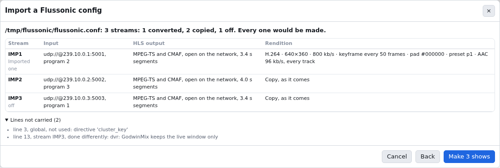
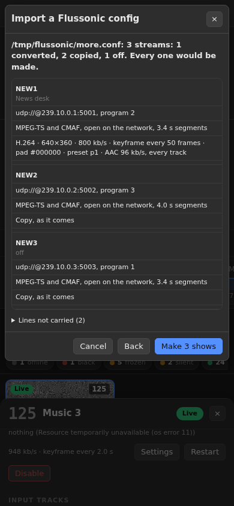

# Replace Flussonic with GodwinMix

A machine that runs Flussonic for a set of TV channels can run GodwinMix in
its place, from the same `flussonic.conf`. GodwinMix reads the file, runs
each `stream` as a show without compositing, and answers Flussonic's
playback URLs and its `/streamer/api/v3` API on the same port. A gateway, a
cache, a player or a monitoring page that reads Flussonic needs no change.

The order is: check the file, run GodwinMix beside Flussonic on another
port, compare, switch, and keep the way back open. Flussonic stays installed
and its config is never rewritten by any of this, unless you edit streams
through GodwinMix's API.

[Reference: the Flussonic facade](../reference/flussonic-facade.md) has every
path and field.

## Install

Install GodwinMix as for any headend ([take headend feeds into direct
shows](headend-feeds.md)). The ingest plugin, which runs the inputs, ships
beside the binary, and `godwinmix headend` installs it into the plugins
folder at start when the folder has none, with the same checks
`gmx plugin add` makes. `gmx plugin add` itself is a mixed show's call and
answers that no show runs, because a headend runs none.

The user GodwinMix runs as needs to read `/etc/flussonic/flussonic.conf`,
and to write it only if you will edit streams through the API.

## Check the file

```sh
godwinmix --config /etc/godwinmix/godwinmix.toml headend --flussonic /etc/flussonic/flussonic.conf --check
```

It prints what it would make and every line it will not carry, and starts
nothing:

```text
/etc/flussonic/flussonic.conf: 52 streams, 51 converted and 1 copied, 0 off
global, not carried: dvr archive: GodwinMix keeps the live window only
```

A stream that asks for something done differently gets a line of its own:

```text
line 40, stream CH455, not carried: pad colour #102030: the bars are drawn black
line 40, stream CH455, not carried: deinterlace=auto: the deinterlacing runs on the CPU, between the GPU decode and the encode
```

`ignored` is a directive or option GodwinMix has no use for. `not carried`
says what GodwinMix does instead: a pad colour other than black, one picture
per field, deinterlacing (which runs on the CPU), a DVR. Every other option
of a `transcoder` line is acted on.

### From the page, or an agent

The same check is **File > Import a Flussonic config**, or the import button
on the headend view's band. Paste the config, or give the path of the file
on the station's machine (the station reads it, so it is that machine's
path), and press **Read it**. Nothing is made yet: the report lists every
stream as the show it becomes, with its input, what its HLS output serves
and its rendition, which streams would be refused and why, and every line
not carried under **Lines not carried**. **Make N shows** then makes them.




This is `headend.import` (an agent's `import_flussonic`, one `search_tools`
away in the `headend` profile): `{"path": "/etc/flussonic/flussonic.conf"}`
is a dry run that answers the report, and `"dry_run": false` makes the
shows. A stream whose show is already there from an earlier import is
refused rather than made twice.

An import makes the shows once. It does not watch the file or answer
Flussonic's URLs and API; `godwinmix headend` below does both. On a station
that already follows a file, the dialog says which, and a show it makes is
not in that file.

## Run it beside Flussonic

Give it another port, so Flussonic keeps 8090 and both run from the same
multicast:

```sh
godwinmix --config /etc/godwinmix/godwinmix.toml headend \
    --flussonic /etc/flussonic/flussonic.conf --port 8091
```

```text
GodwinMix is running. Open http://127.0.0.1:8080/ in a browser.
Headend: Flussonic's URLs and API on http://0.0.0.0:8091/, from /etc/flussonic/flussonic.conf.
```

GodwinMix's own page is on its control port as always, and shows every
stream as a show. Leave out `--port` and it takes the `http` line's port,
which only works once Flussonic is off.

## Compare

With the `edit_auth` user and password from `flussonic.conf`:

```sh
curl -s -u admin:password localhost:8091/streamer/api/v3/streams | jq '.streams[] | {name, status: .stats.status, kbps: .stats.bitrate}'
curl -s localhost:8091/CH117/index.m3u8
ffprobe -v error -show_streams http://localhost:8091/CH117/index.m3u8
```

Every stream should read `running` within a minute. Point a monitoring page
that reads Flussonic's API at the new port, or a player at
`http://host:8091/<name>/index.m3u8`, and compare it with the same stream on
8090. A stream that does not run says why in `stats.last_error` and in the
log.

To have a log in Flussonic's format for a reader that counts scrambled
inputs and refused GPU sessions, add `--flussonic-log` with a path of its
own while Flussonic still writes its log.

## Switch

Stop Flussonic, and start GodwinMix on the `http` port, as a service so it
comes back after a reboot:

```ini
# /etc/systemd/system/godwinmix-headend.service
[Unit]
Description=GodwinMix in place of Flussonic
After=network-online.target
Wants=network-online.target

[Service]
User=godwinmix
Environment=GODWINMIX_SUPERVISED=1
ExecStart=/usr/local/bin/godwinmix --config /etc/godwinmix/godwinmix.toml headend --flussonic /etc/flussonic/flussonic.conf --flussonic-log /var/log/flussonic/flussonic.log
Restart=always

[Install]
WantedBy=multi-user.target
```

```sh
systemctl stop flussonic
systemctl disable flussonic
systemctl enable --now godwinmix-headend
```

Everything that read port 8090 now reads GodwinMix. Segment names are made
from the time each segment began, so a cache in front never confuses one of
GodwinMix's segments with one of Flussonic's.

## Edit streams

Edit `flussonic.conf` as before, by hand or through the API (`PUT` and
`DELETE /streamer/api/v3/streams/<name>`). GodwinMix notices within a second
and restarts only the streams that changed. A file with a mistake changes
nothing, and the log says which line.

You can also edit a stream on the headend screen. That takes it out of the
file's hands: the station keeps it from then on, and later edits to that
stream in the file are not applied until you press Follow the file again
on it. The screen says so before you save. To leave Flussonic's file behind
altogether, import it once (File > Import a Flussonic config) on a station
that does not follow it, and set the channels up on the screen from then
on, as [Set up a headend in GodwinMix](set-up-a-headend.md) describes.

The headend view's band says which file the station follows and where
Flussonic's URLs answer, from `headend.status`:


A station in headend mode starts no mixer, and its page opens on the
headend view. Mixer settings and the Flussonic import work there as on any
station; the settings are the station's own config file.

## Go back

```sh
systemctl disable --now godwinmix-headend
systemctl enable --now flussonic
```

Flussonic reads the same file. Edits made through GodwinMix's API keep
every line it did not change, so Flussonic reads them too.

## What is not there yet

* No DVR: GodwinMix keeps the live window only.
* One rendition per stream: a `transcoder` line with a second `vb=` (a
  ladder) makes the first.
