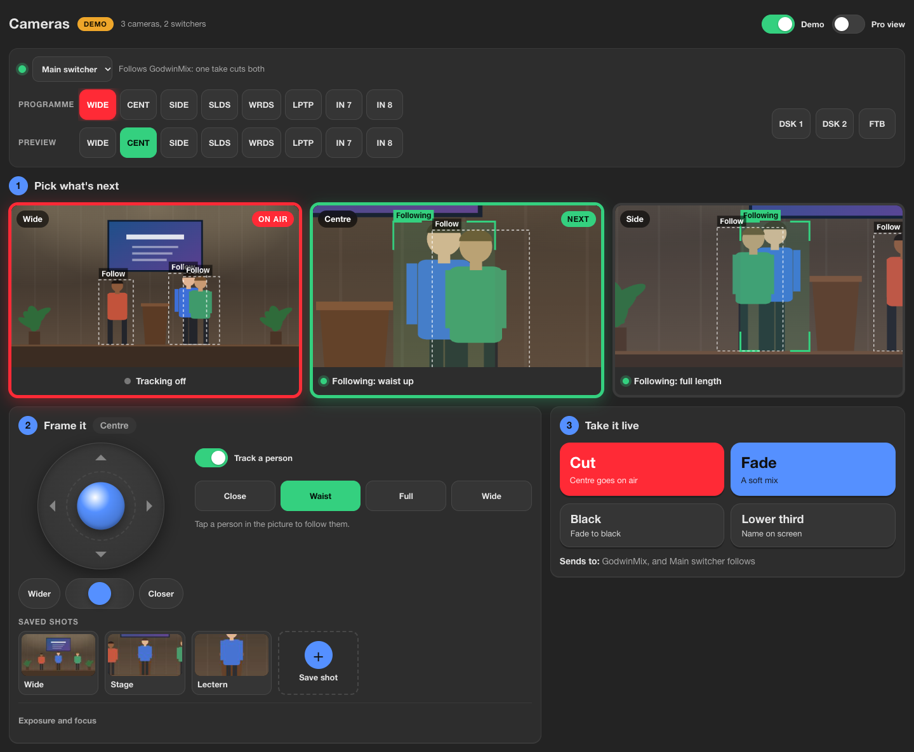
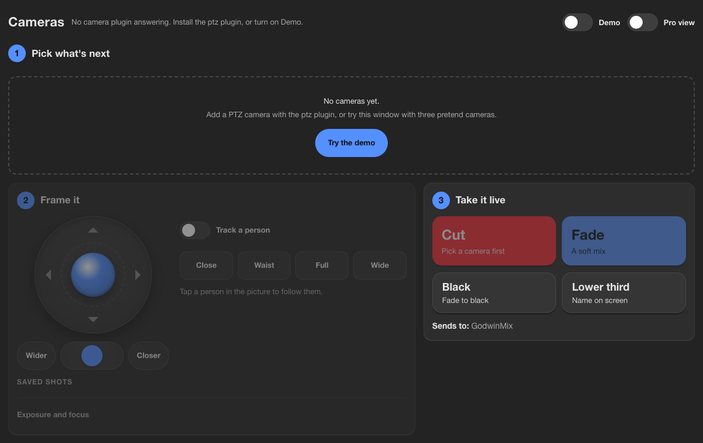
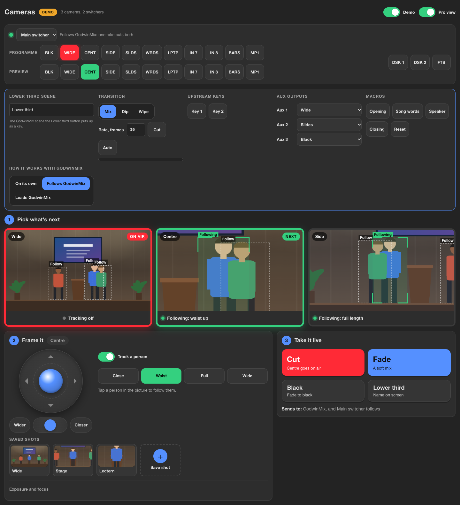
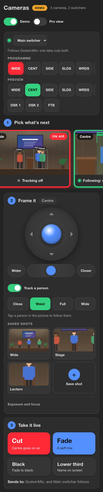
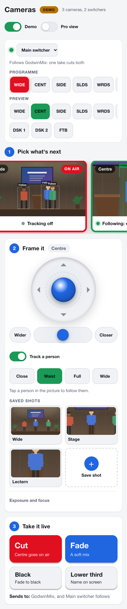
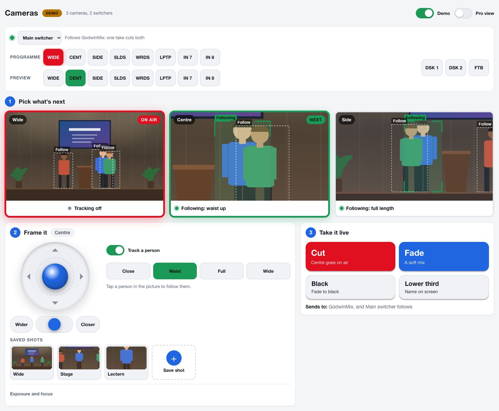

# Run the cameras from one window

The Cameras window puts every PTZ camera on one screen with the switcher
beside them. You pick the next shot, frame it by hand or let the camera
follow the person speaking, and take it live. It is built so somebody who
has never touched a PTZ camera can run a service after a few minutes, and
the full switcher controls are one switch away for whoever knows them.

Open it from **View > Cameras**. On a phone it is under **More**. It reads
nothing and draws nothing until it is on screen, and it stops when you
close it or switch to another workspace.

The cameras come from the `ptz` plugin and the switcher from the `atem`
plugin, which is still being built as this is written. On a mixer without
the `ptz` plugin the window says so and offers the demo. A camera needs its
`source`, the GodwinMix source that shows its picture, for the picture on
its card, for saved shots with pictures and for tracking.

## Try it with the demo

Turn on **Demo** at the top right, or press **Try the demo** in the empty
window. Three pretend cameras look at a small stage where three people
walk about, and two pretend ATEM switchers sit behind them. Everything on
this page works in the demo the same way it works with real cameras, so it
is a good place to practise before a service. The demo runs in your
browser and sends nothing to the mixer; the orange **Demo** badge says
when it is on.

## Step one: pick what's next

Each camera has a card with its live picture. A **red** frame and **On
air** mean the camera is on programme. A **green** frame and **Next** mean
it is the one you are working on, and the one Cut will take. The colours
are the same whether GodwinMix or the ATEM made the cut, so the window
agrees with the tally lights on the cameras.

Tap a card to make it next. The line under the picture says what the
camera is doing by itself:

| Words | Meaning |
|---|---|
| Tracking off | the camera stays where you put it |
| Following: waist up | it is following the person in the green box, in that framing |
| Looking for someone | tracking is on and nobody is chosen yet |
| Lost them, holding the shot | the person left the picture; it keeps the shot for now |
| No picture to track | the camera has no source, or its source has no picture |

The boxes over the picture are the people the camera can see. The bold
green one, labelled **Following**, is the one it follows. Tap any other
box and the camera follows that person instead.

## Step two: frame it

Everything in this step works on the camera that is next.

* **The joystick.** Drag the blue ball and the camera turns that way,
  slowly near the middle and fast at the edge. Let go and it springs back
  and the camera stops. With the joystick selected, the arrow keys do the
  same. If the camera was following someone, it goes back to following
  them when you let go.
* **Zoom.** Slide the blue thumb toward **Closer** or **Wider**, or hold
  either button. Let go and the zoom stops.
* **Track a person.** Turns following on and off. On, it follows whoever
  is nearest the middle of the picture until you tap somebody else.
* **Close, Waist, Full, Wide.** How much of the person to show. Choosing
  one also turns tracking on.
* **Saved shots.** Each saved position is a picture. Tap it and the camera
  goes there. The **+** tile saves where the camera points now as the next
  shot, with a picture taken at that moment.
* **Exposure and focus.** Open the drawer for the exposure mode (Auto,
  Manual, Shutter or Iris) and, off Auto, the iris, shutter and gain in the
  steps the camera's manual numbers them. Focus is automatic until you
  switch it off; then **Nearer** and **Farther** move it while held, and
  **Focus once** sharpens on the middle of the picture and holds. Most
  services never need the drawer.

A camera never keeps turning on its own. The window sends the joystick
about fifteen times a second while you hold it and a stop the moment you
let go, and the camera stops by itself if nothing arrives for a third of a
second, so a closed tab or a dropped network leaves it still. Switching
to another window or app also stops it.

A game controller works too: the left stick points, the right stick
zooms, **A** cuts, **B** fades, and the shoulder buttons pick the camera
before or after. A Stream Deck through Companion reaches the same calls
through the mixer's API.

## Step three: take it live

| Button | GodwinMix | ATEM |
|---|---|---|
| **Cut** | the next camera goes on air at once | preview to the next camera, then cut |
| **Fade** | the next camera mixes in | preview to the next camera, then auto |
| **Black** | the programme goes to black | fade to black, and back when pressed again |
| **Lower third** | the lower third scene goes up as a key, or comes down | downstream key 1 on or off |

The line under the buttons says where they go, which depends on how the
switcher is set to work with GodwinMix:

* **Follows GodwinMix.** GodwinMix takes, and the ATEM cuts to the same
  camera with it. One button drives both.
* **Leads GodwinMix.** The take goes to the ATEM, and GodwinMix's
  programme moves to match. Use this when somebody also works the ATEM's
  own panel.
* **On its own.** The ATEM is not tied to GodwinMix. A choice of
  **GodwinMix**, **Switcher** or **Both** appears under the buttons.

With no switcher, every take goes to GodwinMix.

The lower third scene is called `Lower third` unless you name another in
Pro view, under **Lower third scene**. This browser remembers the name.

## The switcher bar

When a switcher is connected a bar at the top shows it. The dot is green
while the link is up and red when it is not, with what to check. Its
**Programme** row lights red on what is on air and its **Preview** row
green on what is next; tap an input to change either. **DSK 1** and
**DSK 2** put the downstream keys on and off, and **FTB** fades to black
and flashes while it is down. With two switchers a picker replaces the
name.

## Pro view

Turn on **Pro view** for the lower third scene's name, every input on
both switcher rows (black, colour bars and the media player included), and
a panel with the transition style and rate and its progress, the upstream
keys, every aux output, the macros, and how the switcher works with
GodwinMix.

## On a phone or a tablet

The window fits a phone. The cameras scroll sideways with the next one in
the middle, and the steps stack below them. Every button is at least the
size of a fingertip.

The light theme suits a bright room:

## Further reading

* [The camera window's calls](../reference/camera-window.md): every tool and
  method the window sends, for an agent or a control surface that wants to
  do the same.
* [Companion and Stream Deck](companion-and-streamdeck.md).
