# Run PTZ cameras from Sources and Preview

A PTZ camera in GodwinMix is a source like any other. Its tile sits in
Sources with the rest, you put it in Preview the way you put any source
there, and Take or Cut sends it to air. What the camera adds is a way to
steer it: a camera button on its tile that opens **camera properties** in
the side drawer, and, in Studio mode, a small set of controls over the
Preview monitor while that camera is in Preview. An ATEM switcher shows up
in the Programme header and in the Outputs panel.

There is no separate camera window. Everything below is in panels you
already have.

The cameras come from the `ptz` plugin ([add a PTZ camera](add-a-ptz-camera.md))
and the switcher from the `atem` plugin ([connect an ATEM](connect-an-atem.md)).
A camera needs its `source`, the GodwinMix source that shows its picture,
for its tile button, for saved shots with pictures and for tracking.

## The camera tiles

A source that a PTZ camera points at gets a small camera button beside its
gear. While the camera is following someone by itself the tile says so in
a quiet badge on its picture: **Following**, **Holding** when it lost them
for a moment, **Looking** while it waits for someone to follow.

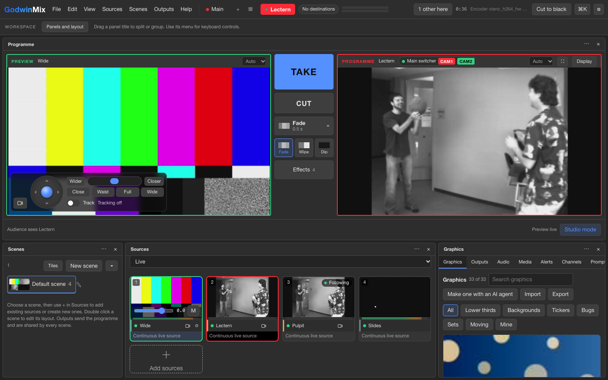

Tap the tile to put the camera in Preview, as with any source. Press the
camera button, or choose **Camera** on the tile's menu, for camera
properties.

## Camera properties

Camera properties opens in the side drawer, where a source's settings open.

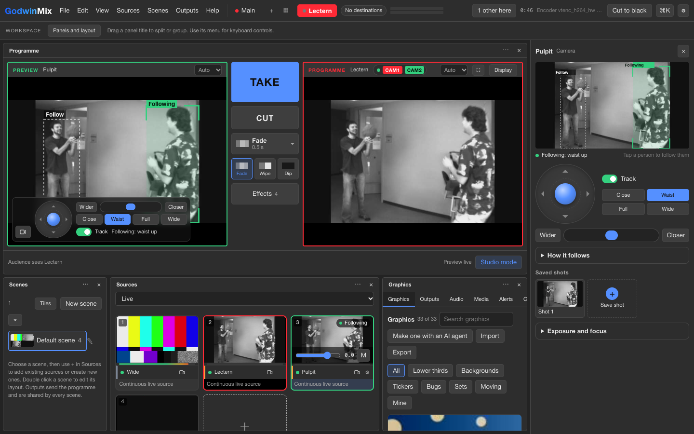

* **The picture.** The camera's live picture with a box round each person
  it can see. The bold green box labelled **Following** is the one it
  follows. Tap anyone else and it follows them instead. The line under the
  picture says what it is doing:

  | Words | Meaning |
  |---|---|
  | Tracking off | the camera stays where you put it |
  | Following: waist up | it is following the person in the green box, in that framing |
  | Looking for someone | tracking is on and nobody is chosen yet |
  | Lost them, holding the shot | the person left the picture; it keeps the shot for now |
  | No picture to track | the camera has no source, or its source has no picture |

* **The joystick.** Drag the ball and the camera turns that way, slowly
  near the middle and fast at the edge. Let go and it springs back and the
  camera stops. With the joystick selected, the arrow keys do the same. If
  the camera was following someone, it goes back to following them when
  you let go.
* **Zoom.** Slide the thumb toward **Closer** or **Wider**, or hold either
  button. Let go and the zoom stops.
* **Track.** Following on and off. On, it follows whoever is nearest the
  middle of the picture until you tap somebody else.
* **Close, Waist, Full, Wide.** How much of the person to show. Choosing one
  also turns tracking on.
* **How it follows.** Folded away until you open it. Speed, Smoothness,
  Room above the head, Lead room, Steadiness and Hold when lost are
  sliders, and **When lost** says whether the camera stays, goes wide or
  goes to a saved shot once the hold runs out. A change takes effect while
  the camera follows. Further right on Smoothness is smoother, and further
  right on Steadiness lets the person move more before the camera does.
* **Saved shots.** Each saved position is a picture. Tap it and the camera
  goes there. The **+** tile saves where the camera points now.
* **Exposure and focus.** Folded away. The exposure mode (Auto, Manual,
  Shutter or Iris) and, off Auto, the iris, shutter and gain. Focus is
  automatic until you switch it off; then **Nearer** and **Farther** move it
  while held, and **Focus once** sharpens on the middle of the picture and
  holds.

The drawer shows **On air** or **In preview** beside the name when the
camera is. It never takes anything to air itself.

A source no camera points at yet offers to add one: say how the camera is
spoken to (VISCA over IP or TCP, ONVIF or Canon) and its address, and press
**Add camera**.

## The camera in Preview

In Studio mode, when Preview holds a camera (the source itself, or a scene
with that one camera in it), the Preview monitor gets the same boxes over
its picture and a small strip in its corner: the joystick, zoom, the
framing chips and Track, with what tracking is doing. Tap a person on the
Preview picture to follow them. The camera button at the strip's left
folds it away to that one button, and this browser remembers which.

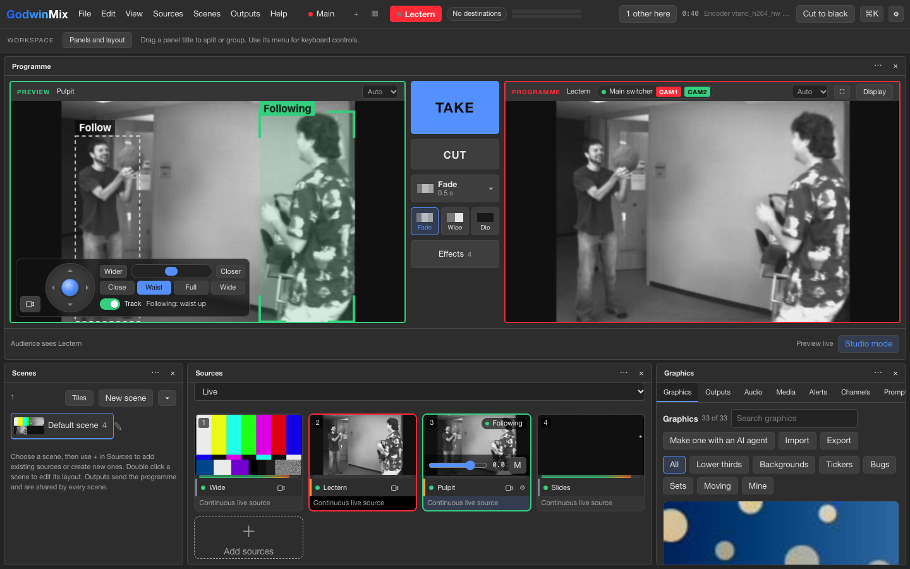

The Programme monitor never gets these controls, so nothing on air moves by
accident. Frame the next shot in Preview, then press **Take** or **Cut**
the way you would for any source.

On a phone, where Preview is small, the strip is just the camera button,
and it opens camera properties.

A camera never keeps turning on its own. The joystick is sent about
fifteen times a second while you hold it and a stop the moment you let go,
and the camera stops by itself if nothing arrives for a third of a second,
so a closed tab or a dropped network leaves it still. Switching to another
window or app also stops it.

A game controller works while camera properties or the Preview strip is
open: the left stick points, the right stick zooms, **A** takes Preview to
programme and **B** cuts. A Stream Deck through Companion reaches the same
calls through the mixer's API.

## An ATEM switcher

Each connected switcher has a chip in the Programme monitor's header: a
dot for its link, its name, and the inputs it has on programme (red) and
preview (green) by their short names. The chip is how you see the switcher
followed a take. When the header is narrow the name gives way to the
inputs.

Press the chip for **switcher properties** in the side drawer. The same
switcher has a row under **ATEM switchers** in the Outputs panel, beside
the destinations, with **Edit** for the same drawer and **Remove**.
**Add switcher** there connects another by its address and a name.

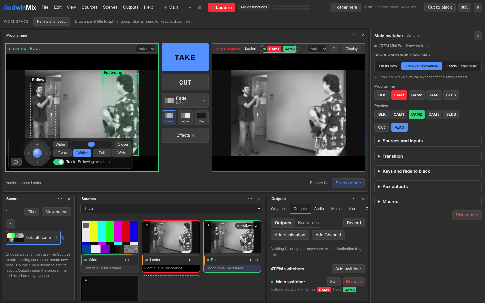

How it works with GodwinMix:

* **Follows GodwinMix.** A GodwinMix take cuts the switcher to the same
  camera. One Take drives both.
* **Leads GodwinMix.** A cut on the switcher's own panel moves GodwinMix's
  programme. Use this when somebody works the switcher's panel.
* **On its own.** The switcher is not tied to GodwinMix. Drive it from this
  drawer or from an agent.

Below the buses and Cut and Auto, folded away: **Sources and inputs** says
which switcher input shows each GodwinMix source (following, leading and
the tally go by this), then **Transition** (style and rate), **Keys and
fade to black** (DSK, upstream keys, FTB), **Aux outputs**, **Macros**, and
**Disconnect**.

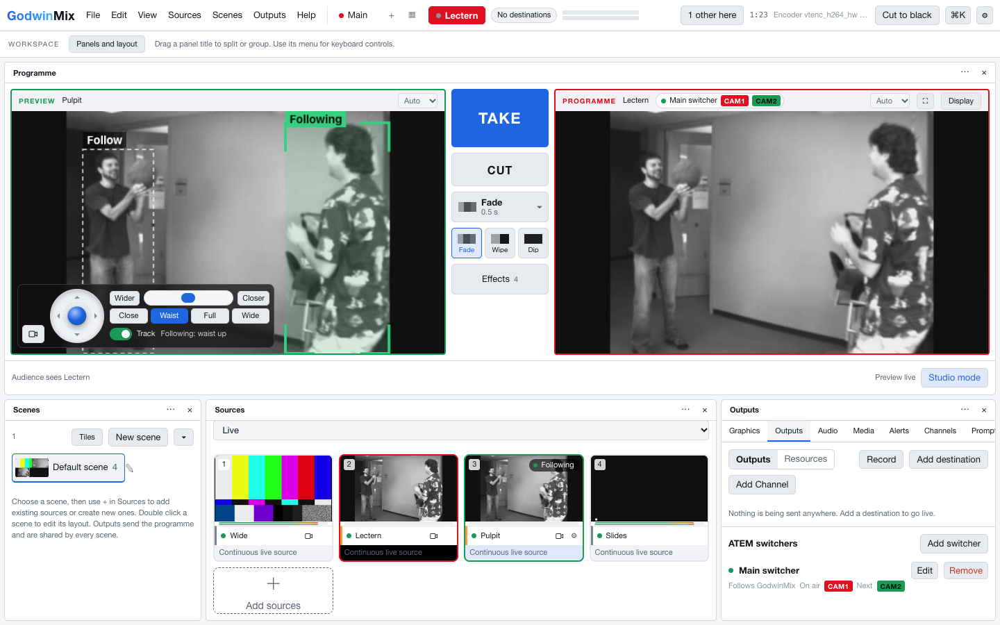

## The Volunteer layout

**View > Volunteer layout**, also under **Panels and layout**, puts up
Preview and Programme in Studio mode with the source tiles below, and
closes every other panel. Tap a camera tile to put it in Preview, steer it
there, then Take. View brings any other panel back.

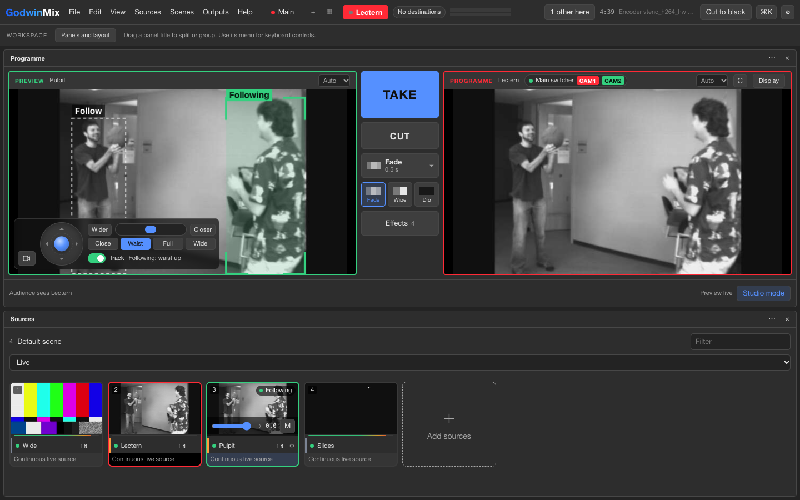

## Try it with simulated cameras

On a mixer without the `ptz` plugin, camera properties says so and offers
**Try with simulated cameras**. Three pretend cameras stand in for the
source you opened it on and the next two video sources, on a small stage
where people walk about, and two pretend ATEM switchers sit behind them.
Everything on this page then works the same way it does with real cameras:
the tile buttons and badges, camera properties, the Preview strip with the
pretend picture under its boxes, the switcher chips, the Outputs rows and
switcher properties. Nothing real moves. **Leave the demo** at the foot of
either drawer turns it off; this browser remembers which.

## On a phone or a tablet

The tiles keep their camera button, and camera properties fills the
screen.

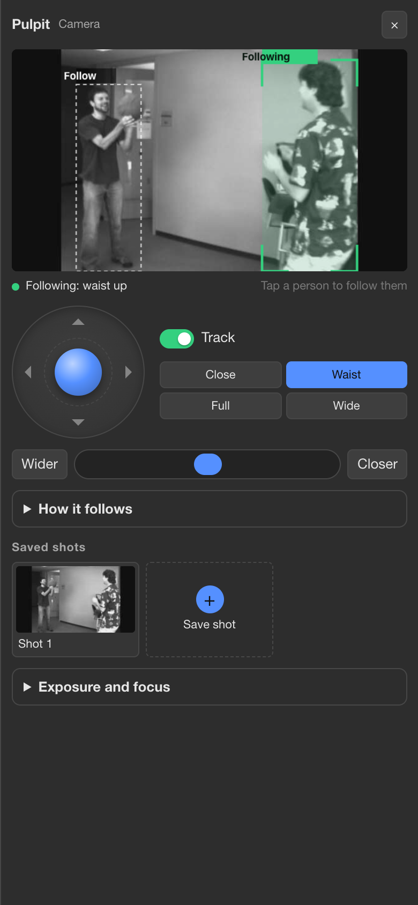
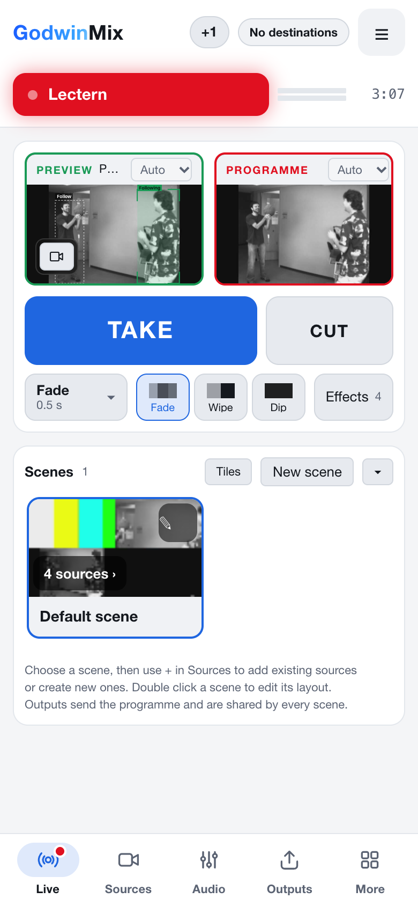
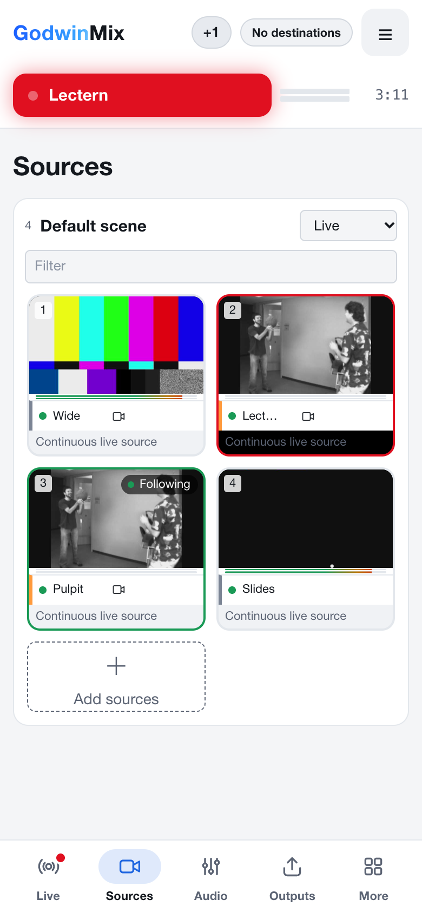

The light theme suits a bright room:

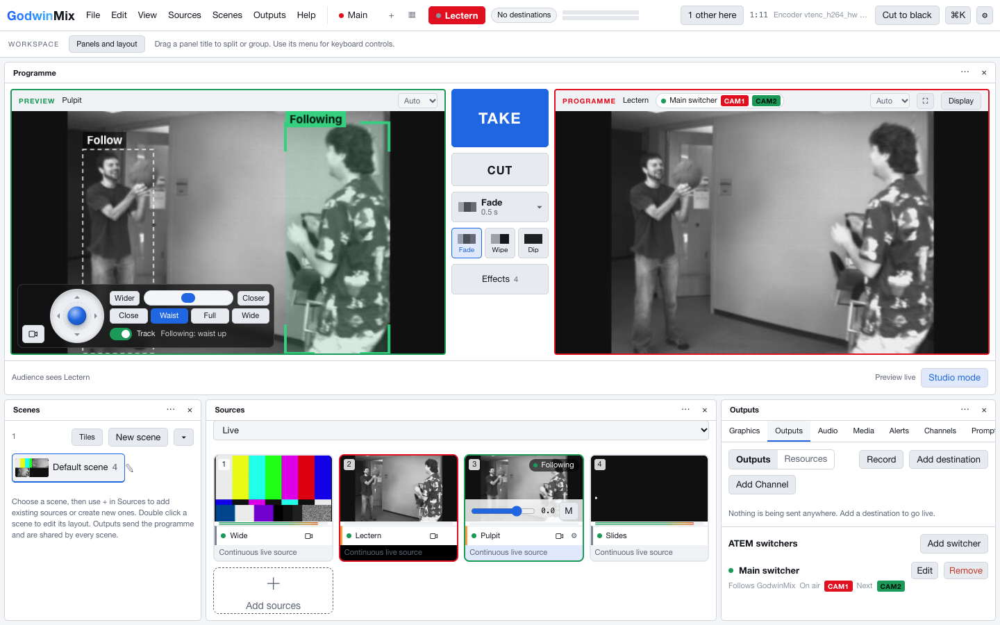
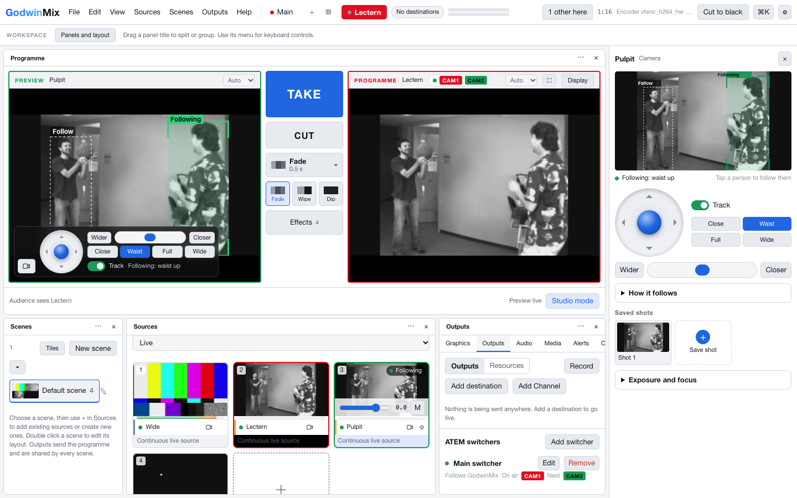
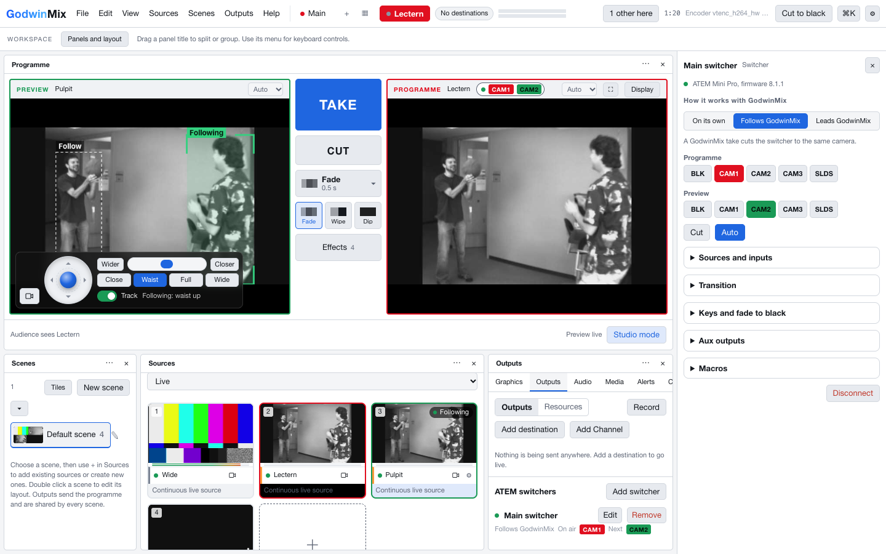
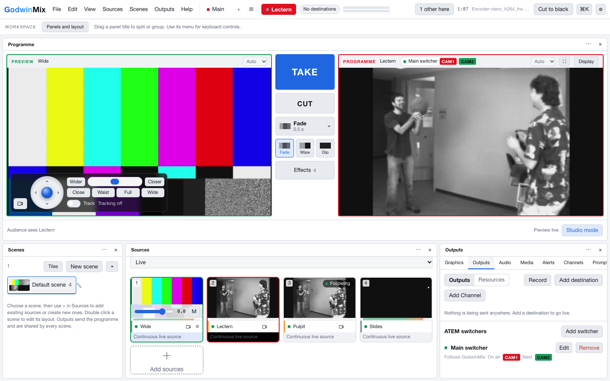
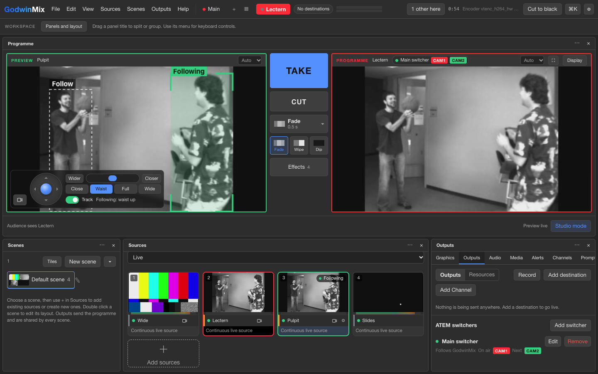

## Further reading

* [The camera and switcher controls' calls](../reference/camera-controls.md):
  every tool and method these send, for an agent or a control surface that
  wants to do the same.
* [Auto track a speaker](auto-track-a-speaker.md).
* [Companion and Stream Deck](companion-and-streamdeck.md).
