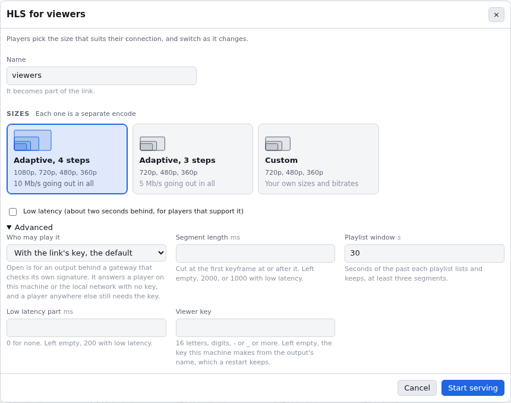
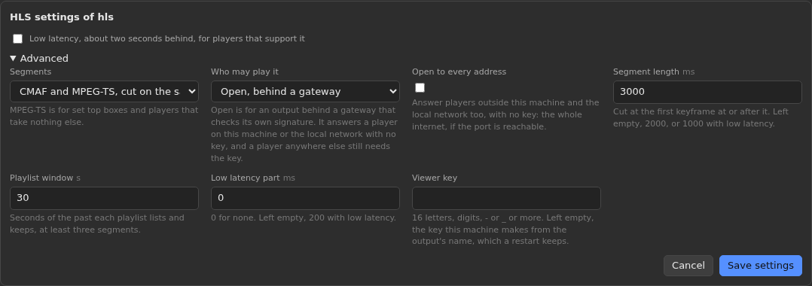
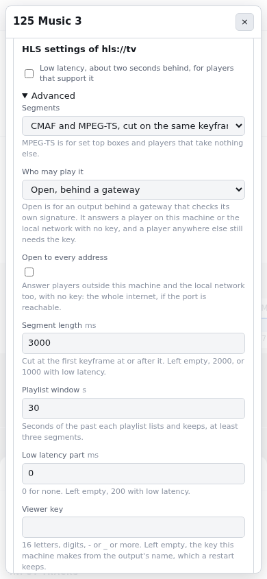

# Serve HLS to viewers

## From the page

HLS lets anyone on your network watch the programme on a phone, a laptop or a
smart TV, with no platform and no stream key. It is served from the mixer's own
port, so there is nothing to open on the router.

### Start it

1. Press **Add destination** on the Outputs panel.
2. Press **HLS for viewers** at the end of the list. It is only there when this
   mixer can serve HLS.
3. Give it a short name. The name becomes part of the link, so `viewers` gives
   `/hls/viewers/master.m3u8`.
4. Pick the sizes a viewer's player can switch between. **Four sizes** is
   1080p, 720p, 480p and 360p, **Three sizes** leaves out 1080p. Each card draws
   its sizes to scale and says how much goes out in all. **Custom** lets you
   add and remove sizes and set each one's bitrate.
5. Tick **Low latency** if the people watching are in the same room and the
   delay matters. Players that do not support it still play, a few seconds
   further behind.
6. Press **Start serving**.

Everything else is under **Advanced**, closed until you open it: who may
play the link (with its key, or open behind a gateway), the segment length,
the playlist window, the low latency part and a viewer key of your own. Left
alone, the dialog sends what it always did: 2 second segments, a 30 second
window, and the key this machine makes.



Every size is its own encode, so a ladder of four costs more than one
destination. If the machine has no room for it, the form says what it needs
and offers what fits, as for any other destination.

### Share the link

Once it is live, the HLS row on the Outputs panel has a card with the link,
a **Copy** button and a QR code. Scan the QR code with a phone on the same
network and it plays. When the page is open on the mixer itself, the link uses
the machine's network address rather than 127.0.0.1, so a phone can reach it.

**Watch here** opens a small preview in the page. Safari, the desktop app on a
Mac and recent Chrome play HLS by themselves. A browser that cannot gets an
**Open in a player** link instead, and a sentence saying why: the page carries
no player of its own, because the smallest one would add about 300 kB to it.

The link carries the output's viewer key, never the control token. The key
lets a player read this one output's playlists and segments and nothing else
on the mixer, and it stays the same when the mixer restarts, so a link on a
poster keeps working. If a link gets somewhere it should not, remove the
output and add it again under a new name.

## From the API

The same thing as one call:

```sh
curl -X POST http://127.0.0.1:8080/api/v1/outputs \
  -H "authorization: Bearer $GODWINMIX_TOKEN" -H 'content-type: application/json' \
  -d '{"id":"viewers","type":"hls/output","uri":"hls://viewers",
       "rendition":{"preset":"abr-ladder-4"},"params":{"low_latency":true}}'
```

Leave `rendition` out to serve the programme exactly as it is encoded, one
size, which costs almost nothing. `docs/reference/hls-output.md` has every
param.

The link is in the output's status:

```sh
curl -s -H "authorization: Bearer $GODWINMIX_TOKEN" \
  http://127.0.0.1:8080/api/v1/outputs/viewers | jq -r .playback.master_url_path
# /hls/viewers/master.m3u8?key=68ydq4dbicw3d8nhsf42ca9c
```

Put the address people reach the mixer on in front of it.

## From a show without compositing

A show that copies a feed straight to its outputs serves HLS too, from the
station's port. Give it an output whose address is `hls://` and a name:

```sh
curl -X POST http://127.0.0.1:8080/api/v1/shows/bbc-one/output/add \
  -H "authorization: Bearer $GODWINMIX_TOKEN" -H 'content-type: application/json' \
  -d '{"uri":"hls://viewers","params":{"segment_ms":2000}}'
```

The feed's own H.264 or HEVC and AAC are packaged as they arrive, with
nothing decoded, and every segment starts on one of the feed's keyframes.
The link is on the output in `show.list`, with the show in it:

```sh
curl -s -H "authorization: Bearer $GODWINMIX_TOKEN" http://127.0.0.1:8080/api/v1/shows \
  | jq -r '.shows[] | select(.id=="bbc-one") | .outputs[] | select(.id=="viewers") | .playback.master_url_path'
# /hls/viewers/master.m3u8?show=bbc-one&key=...
```

A broadcast feed often carries its sound as MPEG audio (MP2) or AC-3, which
HLS players do not take. Such an output is refused, or goes to `failed`, with
an error naming the codec. Ask for AAC and the sound is converted while the
picture is still copied:

```sh
curl -X POST http://127.0.0.1:8080/api/v1/shows/bbc-one/output \
  -H "authorization: Bearer $GODWINMIX_TOKEN" -H 'content-type: application/json' \
  -d '{"output":"viewers","rendition":{"audio":{"codec":"aac"}}}'
```

One rendition is the most such an output carries; a ladder of sizes needs
the show to composite.

### From the page

Open the show from its row on the monitoring wall, or press **Settings** in
a channel's drawer on the headend view. Under **Outputs**:

* **Add output** with an address of `hls://<name>` shows the HLS settings
  under it before the format.
* **HLS settings** on an `hls://` output's row opens what it has now: low
  latency as one click, and under **Advanced** the segments (CMAF, CMAF and
  MPEG-TS, or MPEG-TS alone), who may play it, the segment length, the
  window, the part and the viewer key. **Save settings** sends them all with
  `show.output.set`, which replaces every param, and the output starts again
  on the same link.
* **Format** changes the rendition, with the encoder's finer settings under
  the Custom card's **Advanced** ([Convert broadcast feeds on the
  GPU](convert-broadcast-feeds-on-the-gpu.md)). A format the governor
  refuses stays open with what would fit.

The row says what the output makes, such as `CMAF and TS, open on the
network`. What it was given is read back from the running output, so an
output that is off opens on the defaults and says so.




The packaging runs in a process of its own beside the station, started
while such an output is on. If it stops, the output shows `reconnecting`
in `show.list` with the reason, and comes back on the same link once the
station has started it again, usually within a few seconds; the rest of the
station carries on. `docs/reference/hls-output.md` has the rest.

### Every sound track

A broadcast feed often has two to four sound tracks, one per language. An
HLS output of such a show carries all of them, each as its own rendition
named from the language the feed gives it, the first one the default. A
player that builds its audio menu from the playlist (Safari's, or
`hls.audioTracks` in hls.js) lists them all and switches between them.

### MPEG-TS for older players

Some set top boxes and older players take MPEG-TS segments and nothing
else. Ask for them beside CMAF:

```sh
curl -X POST http://127.0.0.1:8080/api/v1/shows/bbc-one/output/add \
  -H "authorization: Bearer $GODWINMIX_TOKEN" -H 'content-type: application/json' \
  -d '{"uri":"hls://viewers","params":{"segments":"both"}}'
```

The TS link is the CMAF one with `master-ts.m3u8` in place of
`master.m3u8`:

```
/hls/viewers/master-ts.m3u8?show=bbc-one&key=...
```

Its `main` rendition has the picture and the first sound track in one
stream, and each further sound track is a rendition of its own. The TS and
CMAF playlists number and time the same segments. `"segments": "ts"`
serves MPEG-TS alone.

### Behind a gateway

When a gateway in front of the station checks its own signature on every
path, the viewer key is in the way. Make the output open:

```sh
-d '{"uri":"hls://viewers","params":{"segments":"both","access":"open"}}'
```

An open output answers any player on loopback or a private network
without a key, which is where the gateway is. A request from anywhere else
still needs the key, and is told so. Add `"open_public": true` only if the
output is meant to be open to everyone who can reach the port.

## Play it

Any HLS player opens the link: Safari, VLC, a smart TV, `ffplay`, or hls.js
on a web page of your own. To check it from the mixer's own machine:

```sh
ffprobe "http://127.0.0.1:8080/hls/viewers/master.m3u8?key=..."
ffplay "http://127.0.0.1:8080/hls/viewers/master.m3u8?key=..."
```

With low latency on, hls.js (with `lowLatencyMode`, its default) and Safari
play about two seconds behind the camera. A player that does not know LL-HLS
plays the same link a few seconds further back.

A web page on another site can play it too: the control port answers
cross origin requests.

The control port speaks HTTP/1.1. Apple's LL-HLS specification asks for
HTTP/2, so to give Safari and iPhones low latency, put the mixer behind a
reverse proxy with HTTPS (`docs/how-to/reverse-proxy.md`). hls.js needs
nothing more: it keeps two or three requests open, well inside the six a
browser allows one host.

## The same thing as DASH

A player that wants DASH opens `/hls/viewers/manifest.mpd?key=...` instead
(`playback.dash_url_path` in the output's status). It lists the very same
segments, so it costs nothing more to serve; dash.js plays it about six
seconds behind.

## See who is watching

`viewers` on the output's row counts players that fetched something in the
last two windows (a minute, by default), and `egress_kbps` is what they are
pulling between them. Every viewer adds that rung's bitrate to your upload,
so on a home connection a few dozen viewers of 1080p is the limit, whatever
the mixer can do.
