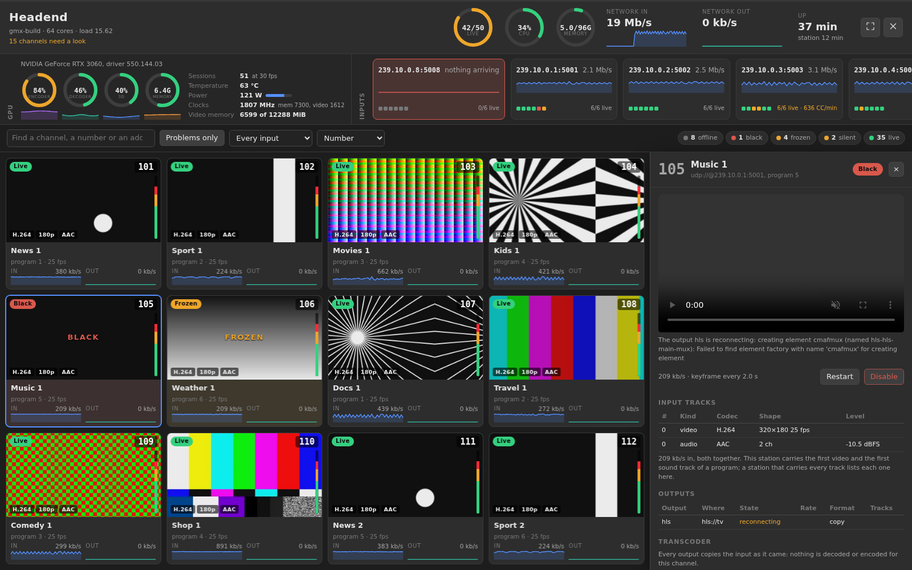
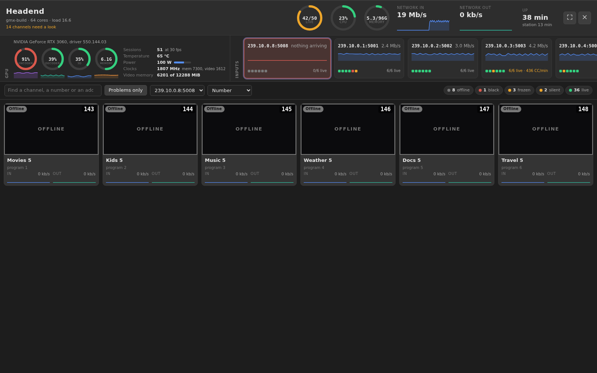
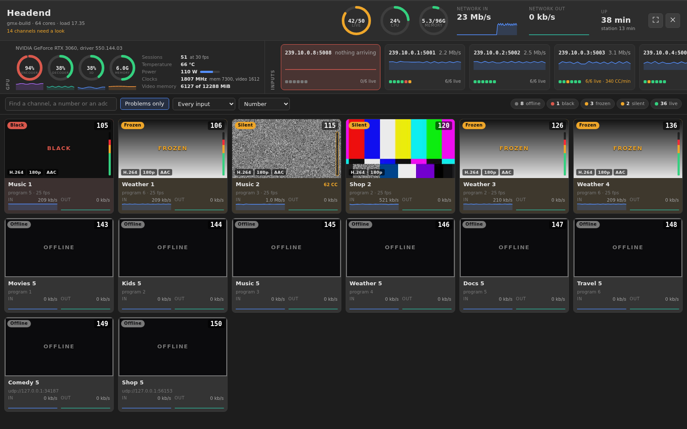
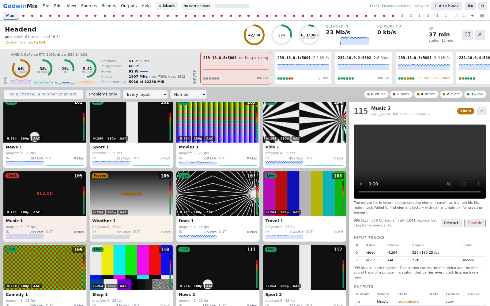
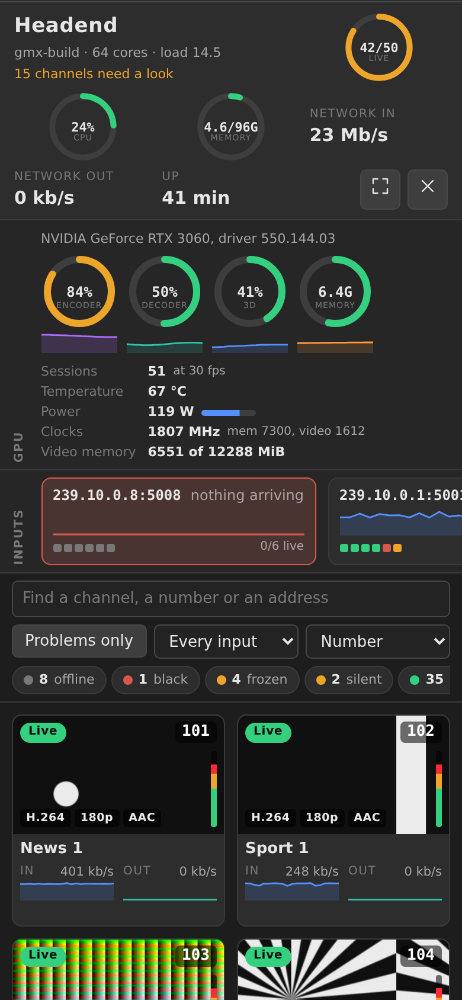
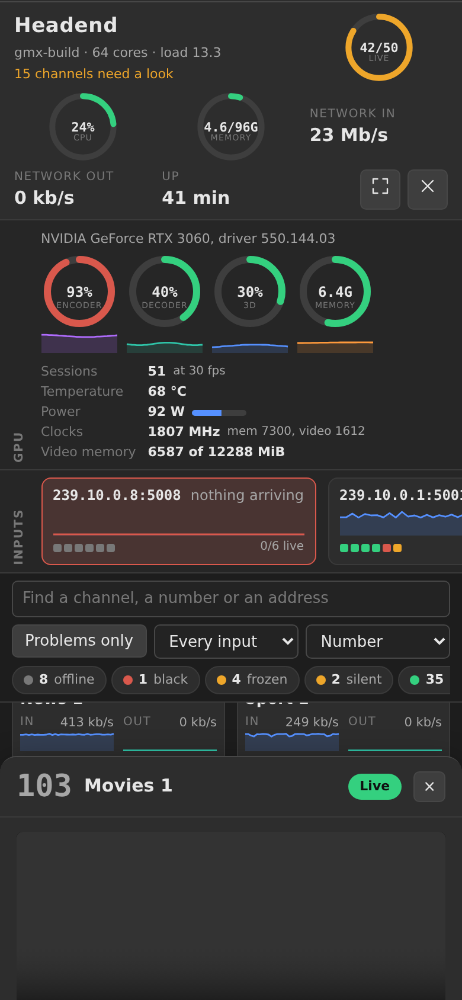

# Watch a headend of many channels

A headend runs dozens of channels on one machine: each a direct show, one
input passed or converted to its outputs, often eight or so multicast
groups carrying six programs each, decoded and encoded on one GPU. The
headend view shows all of it on one screen the way a control room wants
it: every channel as a tile with its picture, the GPU, the input groups
and the box itself, and one channel's detail a click away.

Open it from **View > Headend**, or with **Headend view** on the
monitoring wall's top bar. It reads nothing until it is open and stops
reading when it closes (Escape, or the cross at the top right). The
button beside the cross puts it full screen, for a monitor on the wall.
The first of the three buttons at the top right opens the flow map, which
draws every input, channel, conversion and output as one picture with its
rates ([Read the flow map](read-the-flow-map.md)).

## Read the band

The band along the top is the box:

* **live** is how many channels are sending a picture, of all of them. The
  ring goes amber when any is not.
* **CPU** and **memory** are the whole machine, every process, not only
  GodwinMix. A ring goes amber past 70% and red past 90%.
* **Network in** and **out** are what every channel takes in and what its
  outputs send, with the last minute under each.
* **Up** is how long the machine has been running, and under it the
  station.

The line under the name says how many channels need a look.

## Read the GPU strip

Each NVIDIA GPU gets four rings, the encoder (NVENC), the decoder (NVDEC),
the 3D engine and the video memory, each with two minutes of history
under it, and beside them the open encoder sessions, the temperature,
the power drawn against its limit and the clocks. The station reads these
from NVML once a second while the view is open, or from `nvidia-smi`
where NVML cannot be loaded, and stops ten seconds after the view closes.
On a machine with no NVIDIA card the strip says so in one line.

## Read the input groups

Every address that more than one channel reads is a group: a multicast
group carrying several programs, usually. Each chip has the group's rate
over the last minute, its continuity errors per minute, and a dot per
channel it feeds, coloured as the tile is. When nothing at all arrives on
a group its chip goes red and throbs slowly: six dark tiles are one fault,
upstream of GodwinMix, and the chip says so before anyone reads the six.
Click a chip to see only its channels; click it again for all of them.

## Read a tile

The ring round the picture, and the word in its corner, is the channel's
state, worst first:

| State | What it means |
|---|---|
| Offline | the show is stopped, or nothing arrives on its input |
| No picture | something arrives but there is no video in it, or it stalled |
| Scrambled | the program is encrypted (read when the station reports it) |
| Black | the picture has been black past the alarm's time |
| Frozen | the picture has not changed past the alarm's time |
| Silent | the sound has been under the silence threshold, or there is no sound track |
| Starting | the show is starting, or its first numbers are not in yet |
| Live | the picture and sound are arriving and nothing is wrong |

Black, frozen and silent are the show's own alarms, with the thresholds
set in a show's detail on the monitoring wall. A tile that changes state
pulses three times in its new colour; that is the only animation on a
tile, so movement on the wall always means something moved.

On the picture are the channel's number, its codec and size, and a level
meter for each sound track. The meter is the peak of a short burst of
sound, measured about once a second by the same check the silence alarm
uses, so it moves once a second and not with every syllable. A striped
meter is a track that is not measured. Under the picture are the input
and output rates over the last minute and, in amber, the continuity
errors and lost packets of the last minute.

The number is read from the show's name: name a show `117 Sport` (or
`CH117`) and its tile says 117.

## Find what is wrong

**Problems only** keeps every channel that is not live. The legend at the
right counts the channels in each state; click a state to see only those.
The search box finds a name, a number, an address or a state word, and
`/` puts the cursor in it. The order is the channel number unless you
pick another: worst first, the highest rate or the most errors.

## Open a channel

Click a tile, or tab to it and press Enter. The drawer has:

* a player for the channel's HLS output, the same link a viewer opens. A
  browser that plays HLS by itself (Safari, the macOS app, phones) uses
  its own player; any other uses hls.js, which ships inside GodwinMix and
  is fetched only when a drawer opens. A channel with no HLS output says
  so, and an output that cannot play says why;
* every track coming in with its codec, language, shape, rate and level,
  and every output with where it goes, its state, rate and format;
* the transcoder settings of each output that converts, as they were set;
* the input's history since the page was opened: continuity errors per
  second over two minutes, and each alarm raised and cleared;
* **Restart**, which stops the show and starts it again, and **Disable**,
  which stops it (press twice: the first press asks). A disabled channel
  has **Enable** instead.

## On a phone

At phone width the band folds into three columns, the strips scroll
sideways, the tiles are two across, and the drawer comes up from the
bottom.

## What it costs

With the view open, the page reads `show.stats` for every channel once a
second (the station answers from numbers it already holds, so two hundred
channels cost what one does), `gpu.status` and `machine.status` once a
second, and a picture every two seconds for each tile on screen and no
other. A tile scrolled away stops asking for its picture at once. With
the view closed, none of this is read.

Measured in headless Chromium against a station with fifty channels, the
page drew 55 to 59 frames a second while every tile updated, and 53 to 55
while scrolling through all fifty without a pause. Only the tiles on
screen and two rows either side are in the page, so two hundred channels
cost the same to draw.

## Try it without a headend

`dev/headend-wall.py` starts eight multicast groups of six programs each
and two unicast feeds with GStreamer, a station with fifty channels on
them, and some channels made black, frozen, silent, lossy or dead so
every state shows. `dev/fake-nvidia-smi.py` stands in for `nvidia-smi` on
a machine with no NVIDIA card, so the GPU strip has numbers to draw.
The screenshots on this page were taken that way, with that stand in, on
a Linux machine without the GStreamer element `cmafmux`, which is why the
outputs read 0 kb/s and the player says why it cannot play.

## Related

* [The machine methods](../reference/machine-status.md): `gpu.status` and
  `machine.status`.
* [Monitor many shows](monitor-many-shows.md): the monitoring wall, where
  shows are added and their alarms set.
* [Take headend feeds into direct shows](headend-feeds.md).
